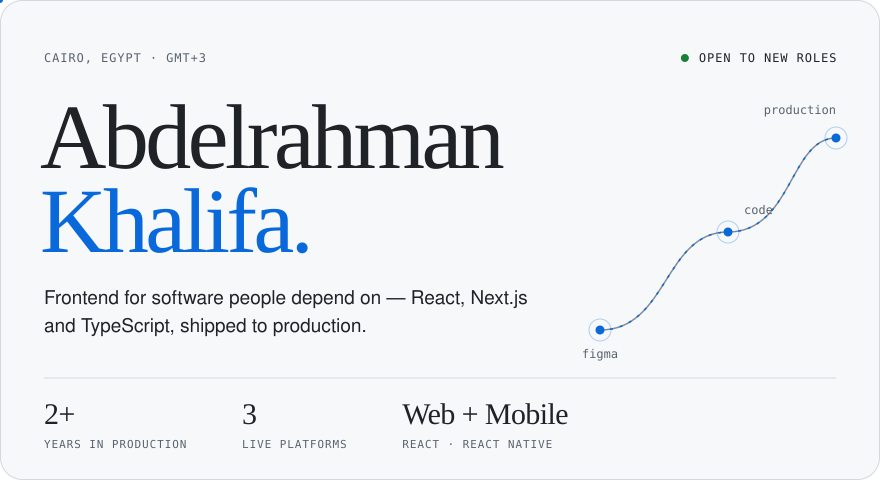
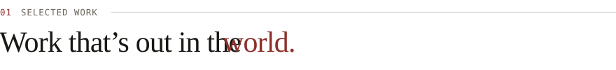
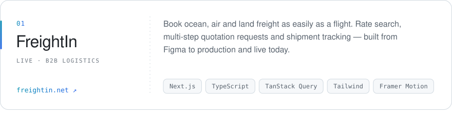
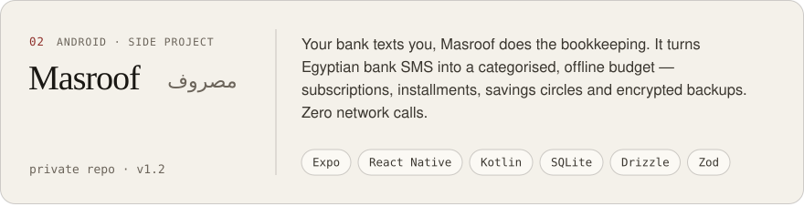
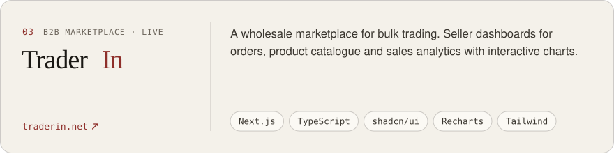
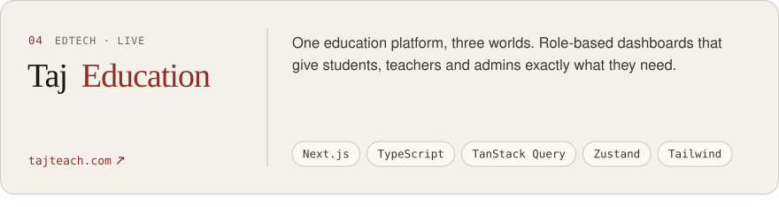
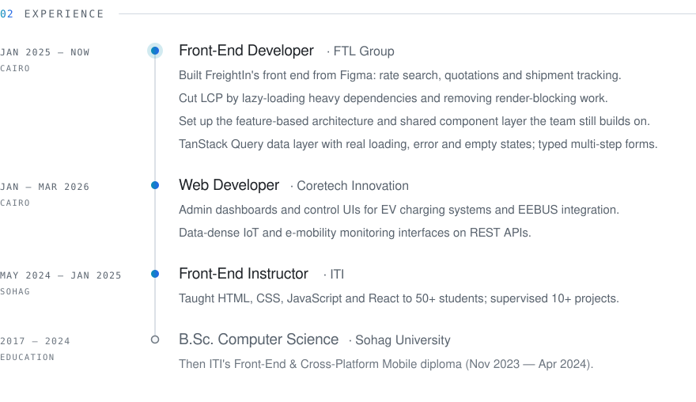
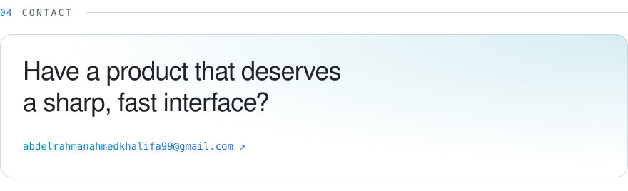

<!--
  Visual sections are generated SVGs (light + dark).
  Edit the content in scripts/build_assets.py, then run:  python3 scripts/build_assets.py
-->

<picture>
  <source media="(prefers-color-scheme: dark)" srcset="./assets/hero-dark.svg"/>
  
</picture>

  <a href="https://www.abdelrahmankhalifa.com/"><b>Portfolio</b></a> &nbsp;·&nbsp;
  <a href="https://www.linkedin.com/in/abdelrahman-ahmed-khalifa"><b>LinkedIn</b></a> &nbsp;·&nbsp;
  <a href="https://x.com/abd0_khalifa"><b>X</b></a> &nbsp;·&nbsp;
  <a href="mailto:abdelrahmanahmedkhalifa99@gmail.com"><b>Email</b></a>

 

<picture>
  <source media="(prefers-color-scheme: dark)" srcset="./assets/work-dark.svg"/>
  
</picture>

<a href="https://freightin.net">
  <picture>
    <source media="(prefers-color-scheme: dark)" srcset="./assets/project-freightin-dark.svg"/>
    
  </picture>
</a>

<picture>
  <source media="(prefers-color-scheme: dark)" srcset="./assets/project-masroof-dark.svg"/>
  
</picture>

<a href="https://traderin.net">
  <picture>
    <source media="(prefers-color-scheme: dark)" srcset="./assets/project-traderin-dark.svg"/>
    
  </picture>
</a>

<a href="https://tajteach.com">
  <picture>
    <source media="(prefers-color-scheme: dark)" srcset="./assets/project-taj-dark.svg"/>
    
  </picture>
</a>

  

<picture>
  <source media="(prefers-color-scheme: dark)" srcset="./assets/experience-dark.svg"/>
  
</picture>

  

<picture>
  <source media="(prefers-color-scheme: dark)" srcset="./assets/toolkit-dark.svg"/>
  
</picture>

  

<a href="mailto:abdelrahmanahmedkhalifa99@gmail.com">
  <picture>
    <source media="(prefers-color-scheme: dark)" srcset="./assets/contact-dark.svg"/>
    
  </picture>
</a>

  <a href="https://www.linkedin.com/in/abdelrahman-ahmed-khalifa">LinkedIn</a> &nbsp;·&nbsp;
  <a href="https://x.com/abd0_khalifa">X</a> &nbsp;·&nbsp;
  <a href="https://www.instagram.com/abdokhalifa_99">Instagram</a> &nbsp;·&nbsp;
  <a href="https://www.abdelrahmankhalifa.com/">abdelrahmankhalifa.com</a>

