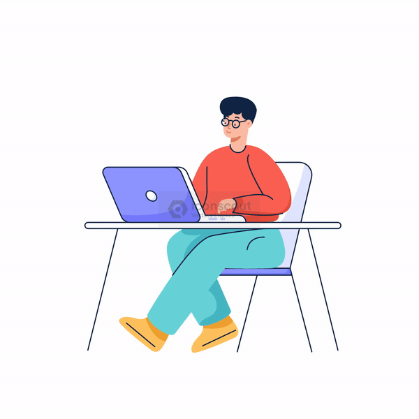

<!-- ============ HEADER ============ -->

  

  

  
  
  
  
  

<!-- ============ ABOUT ============ -->
## 👨‍💻 About Me

Frontend Developer building responsive, high-performance web apps with **React**, **Next.js** and **TypeScript**. I care about clean architecture, smooth UX and shipping fast — and I use AI tools daily for refactoring, debugging and automating the boring parts.

- 🚢 **Now:** Frontend Developer at **FTL Group** — building **FreightIn**, a live B2B maritime logistics platform
- 🧑‍🏫 **Before:** External Instructor at **ITI** — taught 50+ students HTML, CSS, JS & React
- 🎓 **ITI** Front-End & Cross-Platform Mobile · **B.Sc. CS**, Sohag University
- 💬 **Ask me about:** React, Next.js App Router, TanStack Query, Tailwind, animations
- 🌍 Based in **Cairo, Egypt** · open to **remote, hybrid & on-site** roles

 

<!-- ============ STACK ============ -->
## 🧰 Tech Stack

  
   
  
   
  

  
  
  
  
  
  
  

<!-- ============ EXPERIENCE ============ -->
## 💼 Experience

<table>
  <tr>
    <td width="50%" valign="top">
      <h3>🚢 Front-End Developer</h3>
      <b>FTL Group</b> · Cairo 
      Jan 2025 – Present
      <ul>
        <li>Build and maintain <b>FreightIn</b>, a live B2B maritime logistics platform, with Next.js & React</li>
        <li>Applied clean-code practices that cut UI bugs and improved maintainability</li>
        <li>Use AI tools (Claude, ChatGPT) to speed up debugging and refactoring</li>
      </ul>
    </td>
    <td width="50%" valign="top">
      <h3>🧑‍🏫 External Instructor</h3>
      <b>Information Technology Institute (ITI)</b> · Sohag 
      May 2024 – Jan 2025
      <ul>
        <li>Taught 50+ students HTML, CSS, JavaScript and React fundamentals</li>
        <li>Supervised 10+ practical assignments, building students' coding confidence</li>
      </ul>
    </td>
  </tr>
</table>

<!-- ============ PROJECTS ============ -->
## 🚀 Featured Projects

<table>
  <tr>
    <td width="50%" valign="top">
      <h3><a href="https://freightin.net/en">🚢 FreightIn ↗</a></h3>
      Container-booking logistics platform for B2B shipping.  
      
      
      
      
    </td>
    <td width="50%" valign="top">
      <h3>🛒 Trader In</h3>
      B2B e-commerce platform for bulk product trading.  
      
      
      
      
    </td>
  </tr>
  <tr>
    <td width="50%" valign="top">
      <h3>🏨 Oasis Hotel Website</h3>
      SSR hotel website with real-time content and bookings.  
      
      
      
    </td>
    <td width="50%" valign="top">
      <h3>📊 Oasis Hotel Dashboard</h3>
      Hotel management dashboard with charts & reservations.  
      
      
      
      
    </td>
  </tr>
</table>

<!-- ============ STATS ============ -->
## 📈 GitHub Stats

  <picture>
    <source media="(prefers-color-scheme: dark)" srcset="https://github-readme-stats.vercel.app/api?username=AbdoAhmed-Khalifa&show_icons=true&hide_border=true&include_all_commits=true&count_private=true&theme=tokyonight&bg_color=0d1117"/>
    
  </picture>
  <picture>
    <source media="(prefers-color-scheme: dark)" srcset="https://github-readme-stats.vercel.app/api/top-langs/?username=AbdoAhmed-Khalifa&layout=compact&hide_border=true&langs_count=6&theme=tokyonight&bg_color=0d1117"/>
    
  </picture>

  <picture>
    <source media="(prefers-color-scheme: dark)" srcset="https://streak-stats.demolab.com/?user=AbdoAhmed-Khalifa&theme=tokyonight&hide_border=true&background=0d1117"/>
    
  </picture>

<!-- ============ CONNECT ============ -->
## 🤝 Let's Connect

  &nbsp;
  &nbsp;
  &nbsp;
  

  

